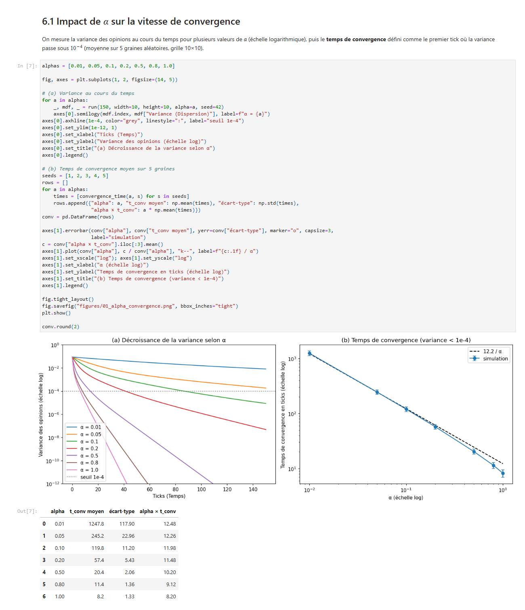

# TP 2 — Simulation Multi-Agent avec Mesa 3

Formation de l'opinion publique : simulation à base d'agents avec **Mesa 3**.

## Contenu du dépôt

| Élément | Description |
|---|---|
| [`TP2Mesa_Simulation_MA.ipynb`](TP2Mesa_Simulation_MA.ipynb) | Notebook Python, **exécuté** (sorties et graphiques inclus) : énoncé + section « À vous » avec les expériences |
| [`REPONSES.md`](REPONSES.md) | Document de réponses aux 8 questions de la section 5, appuyé sur les résultats du notebook |
| [`captures/`](captures) | Captures d'écran du notebook exécuté (code + sorties), une par section |
| [`figures/`](figures) | Graphiques générés par le notebook (enregistrés par `fig.savefig`) |
| [`enonce/`](enonce) | Notebook d'énoncé d'origine, non modifié |
| [`requirements.txt`](requirements.txt) | Dépendances Python |

## Reproduire

```bash
python -m venv .venv
.venv\Scripts\activate            # Linux/macOS : source .venv/bin/activate
pip install -r requirements.txt
jupyter nbconvert --to notebook --execute --inplace TP2Mesa_Simulation_MA.ipynb
```

Testé avec Python 3.10.9 et Mesa 3.0.3. L'exécution complète prend environ une minute.

## Expériences réalisées

| § | Expérience | Question traitée |
|---|---|---|
| 6.1 | Variance et temps de convergence pour 7 valeurs de α ; cas α = 0, 0.01, 0.5, 1 | impact de α |
| 6.2 | Contraction de l'intervalle [min, max] des opinions | consensus inévitable |
| 6.3 | Cartes spatiales des opinions au cours du temps | émergence |
| 6.4 | `AgentSet`, `shuffle_do` vs `do` | activation dans Mesa 3 |
| 6.5 | Forme des tableaux du `DataCollector` | `model_reporters` / `agent_reporters` |
| 6.6 | Voisinage d'un agent du bord avec et sans tore | `torus=True` |
| 6.7 | Biais de confirmation (seuil ε) | ouverture : confiance bornée |
| 6.8 | Réseau sans échelle (`NetworkGrid`) avec influenceur | ouverture : réseau social |

## Captures d'écran

Les captures de [`captures/`](captures) montrent le notebook exécuté, cellule de code et sortie ensemble.
Elles ont été produites à partir du notebook exécuté (rendu HTML par `nbconvert`, puis capture avec le
navigateur Edge en mode headless).

| Capture | Contenu |
|---|---|
| `01_enonce_execution_modele_de_base.png` | Code de l'énoncé exécuté : graphiques globaux et trajectoires |
| `02_environnement_et_modele_parametrable.png` | Versions installées (Mesa 3.0.3) et modèle paramétrable |
| `03_impact_alpha_convergence.png` | Impact de α sur la convergence |
| `04_alpha_cas_extremes.png` | α = 0, 0.01, 0.5, 1 |
| `05_contraction_et_emergence.png` | Contraction min/max et cartes spatiales |
| `06_activation_shuffle_do.png` | `AgentSet` et ordre d'activation |
| `07_datacollector_et_torus.png` | `DataCollector` et voisinage torique |
| `08_biais_de_confirmation.png` | Biais de confirmation |
| `09_reseau_influenceurs.png` | Réseau social et influenceurs |

Aperçu :


