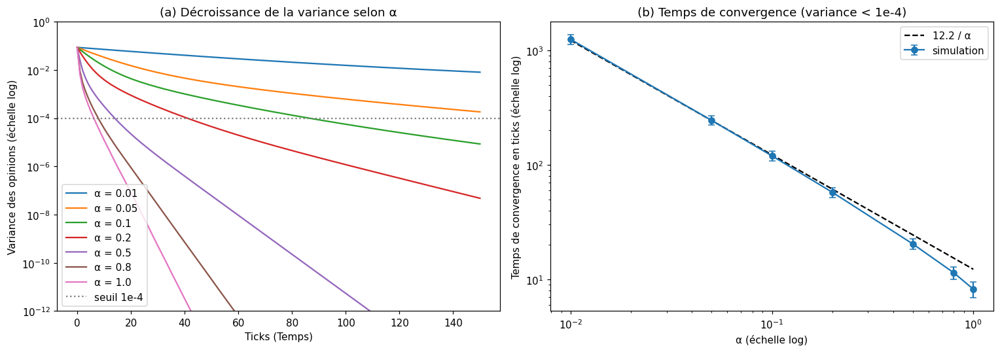
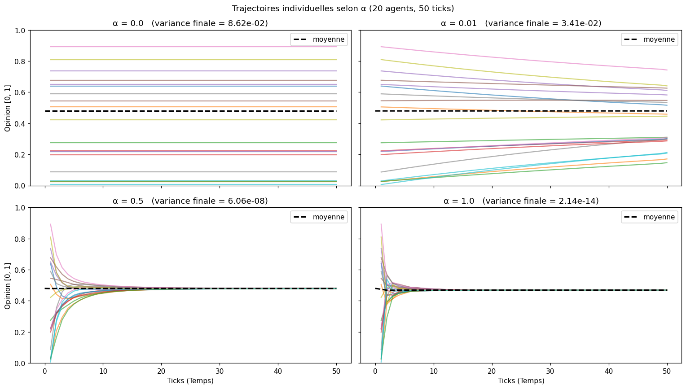
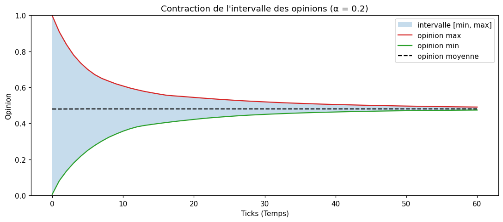
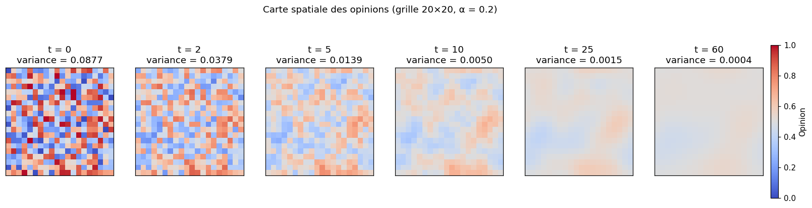
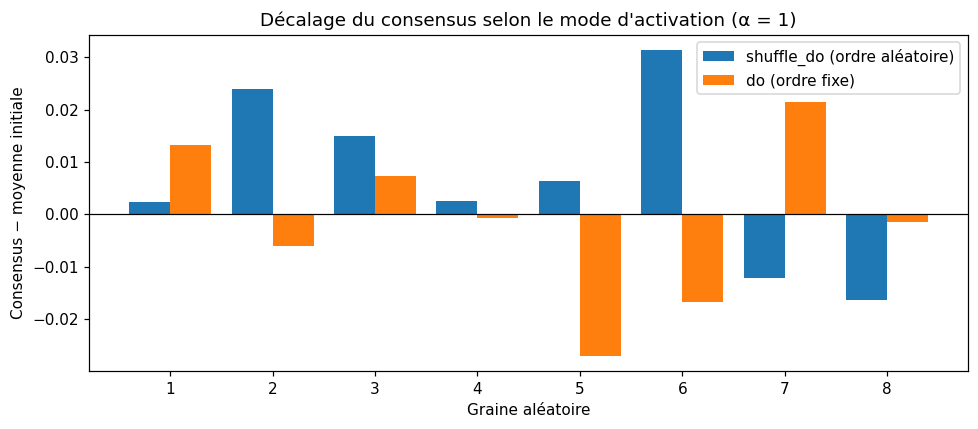
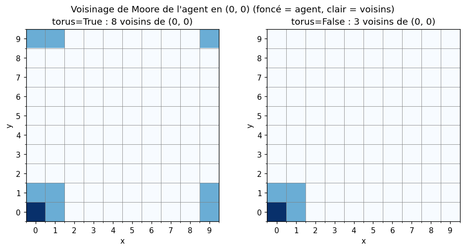
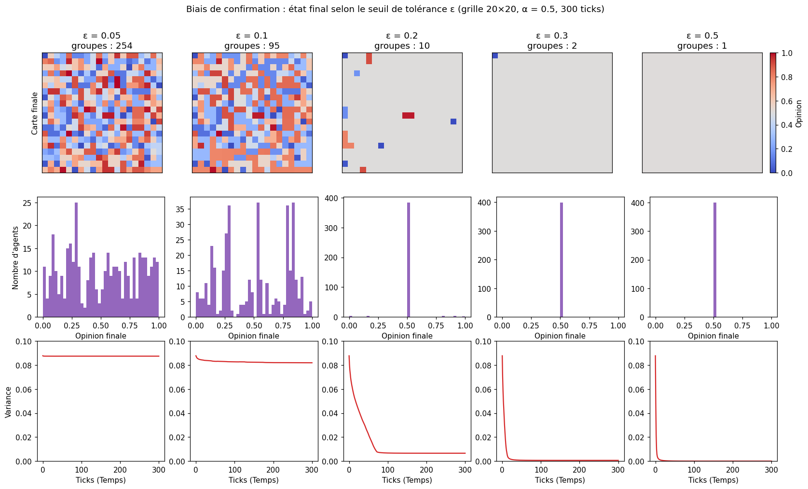
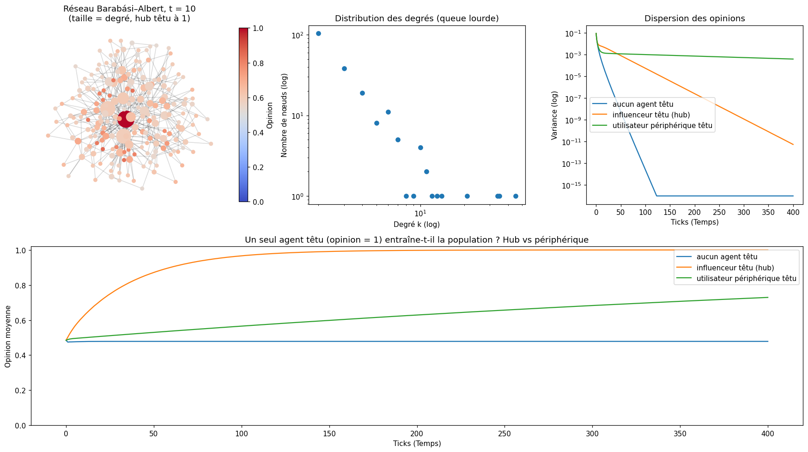

# TP 2 — Simulation Multi-Agent avec Mesa 3 : réponses

**Sujet :** formation de l'opinion publique.
**Notebook :** [`TP2Mesa_Simulation_MA.ipynb`](TP2Mesa_Simulation_MA.ipynb) (exécuté, sorties incluses).
**Environnement :** Python 3.10.9, Mesa 3.0.3, NumPy 2.2.6, pandas 2.3.3, networkx 3.4.2.

Toutes les valeurs chiffrées ci-dessous sont celles produites par le notebook (section « À vous », §6.1 à §6.8).
Les figures se trouvent dans [`figures/`](figures) et les captures du notebook exécuté dans [`captures/`](captures).

> **Correction apportée à l'énoncé.** Avec Mesa 3, `grid.coord_iter()` renvoie `(contenu, (x, y))`.
> La ligne `for _, x, y in self.grid.coord_iter():` lève donc une `ValueError` ; elle a été remplacée par
> `for _, (x, y) in self.grid.coord_iter():`. Aucune autre modification du code fourni.

---

## A. Compréhension théorique

### A.1 — Impact de α sur la vitesse de convergence ; cas α ≈ 0 et α = 1

La règle de mise à jour se réécrit

$$o_i^{t+1} = (1-\alpha)\,o_i^t + \alpha\,\bar{o}_{\mathcal{N}_i}^{\,t}$$

α est donc la **fraction de l'écart** entre l'agent et ses voisins qui est comblée à chaque activation :
c'est un pas de relaxation. Plus α est grand, plus l'écart se referme vite.

**Mesure (§6.1).** Temps de convergence = premier tick où la variance des opinions passe sous 10⁻⁴,
grille 10×10, moyenne sur 5 graines :

| α | 0.01 | 0.05 | 0.1 | 0.2 | 0.5 | 0.8 | 1.0 |
|---|---|---|---|---|---|---|---|
| Temps de convergence (ticks) | 1247.8 | 245.2 | 119.8 | 57.4 | 20.4 | 11.4 | 8.2 |
| α × temps | 12.48 | 12.26 | 11.98 | 11.48 | 10.20 | 9.12 | 8.20 |

Le temps de convergence est **inversement proportionnel à α** (≈ 12/α) tant que α est petit : diviser α par 10
multiplie le temps par 10. Pour α proche de 1, la convergence est même un peu plus rapide que cette loi
(le produit α × temps descend à 8.2). Sur la figure, la variance décroît de façon exponentielle
(droite en échelle logarithmique) avec une pente d'autant plus raide que α est grand.



**Cas limites (§6.1, seconde figure) :**

* **α = 0** : `opinion + 0 × (...)` — l'opinion ne change jamais. Les trajectoires sont des **droites horizontales
  parallèles**, la variance reste à sa valeur initiale (≈ 0.086) et il n'y a aucune dynamique.
* **α très proche de 0 (0.01)** : les courbes se resserrent très lentement, en éventail quasi plat. Après 50 ticks
  la population est encore largement dispersée ; il faut plus de 1 200 ticks pour atteindre le seuil.
* **α = 1** : l'agent **abandonne entièrement son opinion** et adopte la moyenne de ses voisins
  (`opinion = mean_opinion`). Les trajectoires font des sauts brusques au premier tick puis se rejoignent en
  moins de 10 ticks. La convergence est la plus rapide, mais l'agent n'a plus aucune inertie : la valeur
  du consensus s'écarte davantage de la moyenne initiale (voir A.2 et B.1).



### A.2 — Pourquoi la polarisation est impossible avec cette configuration

Trois propriétés de `step()` se combinent :

1. **La mise à jour est une combinaison convexe.** Puisque α ∈ [0, 1], la nouvelle opinion est une moyenne
   pondérée de l'opinion de l'agent et de celles de ses voisins. Elle est donc toujours **entre** les valeurs
   extrêmes de son voisinage : aucun agent ne peut s'éloigner des autres ni dépasser le maximum (ou passer sous
   le minimum) de la population. Le maximum global ne peut que diminuer, le minimum qu'augmenter. Le notebook le
   vérifie (§6.2) : max décroissant = `True`, min croissant = `True`.
2. **L'influence est inconditionnelle.** L'agent écoute *tous* ses voisins, quel que soit l'écart d'opinion.
   Il n'existe aucune force de répulsion ni aucun seuil qui permettrait à deux groupes de s'ignorer.
3. **Le graphe d'interaction est fixe et connexe.** Sur la grille torique, chaque agent a 8 voisins et tout agent
   est relié à tout autre par une chaîne de voisins ; les agents ne se déplacent pas.

Conséquence : un état stable exige que chaque agent soit égal à la moyenne de ses voisins. Sur un graphe connexe,
l'agent qui porte l'opinion maximale ne peut être égal à la moyenne de ses voisins que si tous ses voisins ont la
même opinion que lui, et de proche en proche toute la population : **le seul état d'équilibre est le consensus**.
Mathématiquement c'est un modèle de moyennage de type DeGroot, c'est-à-dire une diffusion (équation de la chaleur
discrète) qui lisse toutes les différences.



Remarque : la valeur du consensus est proche de la moyenne initiale mais pas exactement égale
(0.4796 → 0.4800 pour α = 0.2), car l'activation est asynchrone : chaque agent voit des voisins dont
certains ont déjà été mis à jour dans le même tick, et la moyenne n'est donc pas strictement conservée.

### A.3 — L'émergence dans les graphiques

Dans le protocole ODD, l'émergence désigne un comportement **global** qui n'est écrit nulle part dans les règles
**individuelles**. Ici, le code de l'agent ne contient ni objectif collectif ni connaissance de la population :
il lit 8 voisins et fait une moyenne. Pourtant :

* **Graphique global** : la variance tombe vers 0 alors que l'opinion moyenne reste presque constante. La
  population « s'accorde » sur une valeur que personne n'a choisie et qu'aucun agent ne connaît.
* **Trajectoires individuelles** : des courbes parties de valeurs aléatoires entre 0 et 1 se rejoignent en un
  seul faisceau — c'est la signature visuelle du consensus.
* **Cartes spatiales (§6.3)** : à t = 0 la grille est un bruit aléatoire (variance 0.0877) ; à t = 2 à 10
  apparaissent des **zones locales** de même couleur (des « quartiers » d'opinion, structure intermédiaire
  elle aussi non programmée) ; ces zones fusionnent ensuite jusqu'à une teinte uniforme.

L'ordre global naît donc uniquement de la répétition d'interactions locales, sans coordination centrale.



---

## B. Technique et manipulation de Mesa 3

### B.1 — Activation avec `self.agents.shuffle_do("step")`

Dans Mesa 3, le module `mesa.time` (schedulers `RandomActivation`, etc.) n'est plus nécessaire. Chaque agent
s'enregistre dans le modèle à l'appel de `super().__init__(model)` et `model.agents` est un **`AgentSet`** :
une collection qui sait appliquer une opération à tous ses membres.

| Itération classique | Mesa 3 |
|---|---|
| `agents = list(...)` ; `random.shuffle(agents)` ; `for a in agents: a.step()` | `self.agents.shuffle_do("step")` |
| il faut tenir la liste à jour (ajouts, retraits) et gérer le générateur aléatoire | l'enregistrement est automatique, le mélange utilise le générateur du modèle (reproductible avec `seed`) |
| ordre fixe : `for a in agents: a.step()` | `self.agents.do("step")` |

`shuffle_do` mélange puis appelle la méthode sur chaque agent, en une seule opération ; un agent supprimé en cours
de tick n'est pas appelé. L'`AgentSet` offre aussi `select`, `get`, `set`, `agg`, `groupby` — le notebook (§6.4)
montre `len(model.agents)`, `agents.get("opinion")` et `agents.select(...)`.

**Intérêt de l'ordre aléatoire.** L'activation est *séquentielle* : un agent activé tard voit des voisins déjà
mis à jour. Avec un ordre fixe, ce sont toujours les mêmes agents qui parlent en premier et les mêmes qui
réagissent en dernier ; ici l'ordre de création balaie la grille case par case, ce qui introduit un sens de
propagation artificiel. Tirer un nouvel ordre à chaque tick évite qu'un tel **artefact d'ordonnancement**
se répète systématiquement : aucun agent n'est privilégié en moyenne. Le notebook confirme que l'ordre change à
chaque tick (`[92, 67, 74, …]` puis `[76, 5, 88, …]`) alors que `do` donne toujours `[1, 2, 3, …]`.

**Résultat honnête de l'expérience (§6.4).** Avec α = 1 sur 8 graines, les deux modes atteignent le consensus et
le décalage entre consensus et moyenne initiale est du même ordre (écart absolu moyen 0.0137 pour `shuffle_do`,
0.0117 pour `do`). Dans ce modèle symétrique et homogène, l'ordre ne change donc pas le résultat qualitatif :
l'ordre aléatoire est une **précaution méthodologique** (ne pas dépendre d'un ordre arbitraire), pas un
ingrédient nécessaire au consensus. Ce que l'expérience montre en revanche, c'est que la valeur finale dépend de
l'ordre d'activation : elle n'est pas déterminée par les seules opinions initiales.



### B.2 — `model_reporters` et `agent_reporters`

| | `model_reporters` | `agent_reporters` |
|---|---|---|
| Ce qui est mesuré | une valeur **par tick** pour tout le modèle | une valeur **par agent et par tick** |
| Définition | fonction du modèle (`lambda m: ...`) | nom d'attribut (`"opinion"`) ou fonction de l'agent |
| Récupération | `get_model_vars_dataframe()` | `get_agent_vars_dataframe()` |
| Forme (50 ticks, 100 agents, §6.5) | 51 lignes × 1 colonne par indicateur | 5 000 lignes, index double `(Step, AgentID)` |

Les deux sont nécessaires car ils répondent à des questions différentes :

* les indicateurs **agrégés** (moyenne, variance) disent *si* la population converge et *à quelle vitesse* ;
* les données **individuelles** disent *comment* : elles donnent les trajectoires et la distribution des opinions.

Un agrégat seul est ambigu. Une moyenne de 0.5 décrit aussi bien un consensus neutre qu'une population coupée
en deux camps à 0 et à 1. Une variance non nulle ne distingue pas un étalement uniforme de deux ou trois groupes
compacts. Seules les données par agent (trajectoires, histogrammes, cartes) permettent de reconnaître un
consensus, une polarisation ou des clusters — c'est exactement ce qui sert dans l'expérience sur le biais de
confirmation (C.1). À l'inverse, recalculer les agrégats à partir du tableau des agents est possible mais lourd :
les `model_reporters` les fournissent directement.

### B.3 — Effet de `torus=True` sur un agent du bord

Avec `torus=True`, la grille est repliée sur elle-même : le bord gauche est collé au bord droit et le bas au
haut. Les coordonnées des voisins sont calculées **modulo** la largeur et la hauteur. Résultats du notebook
(§6.6, grille 10×10, voisinage de Moore) :

| Position | `torus=True` | `torus=False` |
|---|---|---|
| coin `(0, 0)` | 8 voisins, dont `(9, 0)`, `(9, 1)`, `(9, 9)`, `(0, 9)`, `(1, 9)` | 3 voisins : `(0, 1)`, `(1, 0)`, `(1, 1)` |
| bord `(0, 5)` | 8 voisins, dont `(9, 4)`, `(9, 5)`, `(9, 6)` | 5 voisins |
| centre `(5, 5)` | 8 voisins | 8 voisins |
| Répartition | 100 agents à 8 voisins | 4 à 3 voisins, 32 à 5, 64 à 8 |

Un agent en `x = 0` a donc pour voisins de gauche les agents de la colonne `x = width − 1`. Conséquences :
tous les agents ont le même nombre de voisins (pas d'**effet de bord**), l'espace est homogène et se comporte
comme un échantillon d'une population plus grande. Sans tore, les agents du bord moyennent sur moins de voisins,
chacun pesant alors davantage.



---

## C. Ouverture et esprit critique

### C.1 — Introduire un biais de confirmation (seuil de tolérance ε)

Il suffit de **filtrer les voisins** avant de calculer la moyenne : l'agent ignore ceux dont l'opinion est trop
éloignée de la sienne. Code utilisé dans le notebook (`CitizenAgentV2`, §6.0) :

```python
class CitizenAgentV2(mesa.Agent):
    def __init__(self, model, alpha, epsilon=None):
        super().__init__(model)
        self.opinion = self.model.random.random()
        self.alpha = alpha
        self.epsilon = epsilon          # seuil de tolérance

    def step(self):
        neighbors = self.model.grid.get_neighbors(self.pos, moore=True, include_center=False)

        # Biais de confirmation : on n'écoute que les voisins "assez proches" de sa propre opinion
        if self.epsilon is not None:
            neighbors = [n for n in neighbors if abs(n.opinion - self.opinion) < self.epsilon]

        if len(neighbors) > 0:          # si personne n'est assez proche, l'agent ne bouge pas
            mean_opinion = np.mean([n.opinion for n in neighbors])
            self.opinion = self.opinion + self.alpha * (mean_opinion - self.opinion)
```

C'est le principe des modèles à **confiance bornée** (Deffuant–Weisbuch, Hegselmann–Krause). Le changement
essentiel par rapport à A.2 : le graphe d'influence **dépend maintenant des opinions**. Deux voisins trop
éloignés ne se parlent plus ; le réseau peut se déconnecter et chaque morceau converge de son côté.

**Résultats (§6.7, grille 20×20, α = 0.5, 300 ticks).** Un « groupe » est une composante connexe du graphe des
voisins qui s'influencent encore à la fin.

| ε | Variance finale | Opinions finales | Groupes | Plus grand groupe | Agents isolés |
|---|---|---|---|---|---|
| 0.05 | 0.0874 | 0.00 – 1.00 | 254 | 11 | 180 |
| 0.10 | 0.0819 | 0.00 – 1.00 | 95 | 96 | 56 |
| 0.20 | 0.0066 | 0.00 – 0.98 | 10 | 384 | 5 |
| 0.30 | 0.0006 | 0.01 – 0.50 | 2 | 399 | 1 |
| 0.50 | 0.0000 | 0.51 – 0.51 | 1 | 400 | 0 |



**Phénomène social qui émerge : la fragmentation de l'opinion en « chambres d'écho ».**

* **ε faible (0.05 – 0.1)** : presque personne ne trouve d'interlocuteur acceptable. La population se fige en une
  mosaïque de petits groupes homogènes et d'individus isolés ; la variance ne baisse pratiquement pas. Les
  histogrammes montrent plusieurs pics : des **clusters d'opinion** coexistent durablement, y compris aux extrêmes.
* **ε intermédiaire (0.2)** : une majorité centriste se forme (384 agents sur 400), mais il subsiste des
  **minorités extrémistes** proches de 0 et de 1 qui n'écoutent plus personne et restent figées.
* **ε grand (≥ 0.5)** : tout le monde s'écoute, on retrouve le consensus du modèle initial.

Il existe donc un **seuil de tolérance critique** : en dessous, consensus impossible. Le résultat illustre
comment le simple fait de n'écouter que ceux qui pensent déjà comme soi suffit à produire polarisation et
bulles de filtres, sans aucune hostilité entre les groupes.

### C.2 — Modéliser un vrai réseau social avec des influenceurs

**Structure Mesa :** `mesa.space.NetworkGrid`, qui place les agents sur les nœuds d'un graphe `networkx` ; le
voisinage n'est plus géographique mais défini par les arêtes (`grid.get_neighbors(node_id)`).
Mesa 3 propose aussi l'équivalent dans le nouvel espace `mesa.experimental.cell_space.Network`.

**Topologie :** un graphe **sans échelle** (scale-free) de **Barabási–Albert**, `nx.barabasi_albert_graph(n, m)`.
Il est construit par *attachement préférentiel* — un nouvel utilisateur s'abonne de préférence aux comptes déjà
populaires — ce qui produit une distribution des degrés en loi de puissance : quelques **hubs** très connectés
(les influenceurs) et une grande majorité de nœuds peu connectés. Pour un vrai graphe d'abonnés, où la relation
n'est pas réciproque, on prendrait un graphe **orienté** (`nx.DiGraph`, par exemple `nx.scale_free_graph`) et
l'agent ne moyennerait que les opinions des comptes qu'il suit. Un graphe d'Erdős–Rényi ou une grille ne
conviendraient pas : tous les nœuds y ont à peu près le même degré.

**Vérification (§6.8).** Réseau de 200 nœuds et 396 arêtes : degré médian 2, moyen 3.96, **maximum 45** ;
les 10 nœuds les plus connectés (5 %) portent 26 % des extrémités d'arêtes. Pour mesurer le poids d'un
influenceur, un seul agent est rendu « têtu » (opinion fixée à 1, jamais mise à jour) :

| Scénario | Moyenne t = 0 | t = 10 | t = 50 | t = 100 | t = 400 | Ticks pour moyenne ≥ 0.9 |
|---|---|---|---|---|---|---|
| Aucun agent têtu | 0.4842 | 0.4777 | 0.4785 | 0.4785 | 0.4785 | jamais |
| Influenceur têtu (hub, degré 45) | 0.4850 | 0.6233 | 0.8717 | 0.9665 | 1.0000 | 60 |
| Utilisateur périphérique têtu (degré 2) | 0.4850 | 0.4995 | 0.5299 | 0.5656 | 0.7292 | pas atteint en 400 ticks |



Le même comportement (ne jamais changer d'avis) a un effet très différent selon la position dans le réseau :
l'influenceur entraîne toute la population vers son opinion en 60 ticks environ, alors que l'utilisateur
périphérique n'a déplacé la moyenne que de 0.485 à 0.729 après 400 ticks. Sur un réseau sans échelle, l'opinion
publique dépend donc fortement de quelques nœuds centraux — ce que la grille régulière, où tous les agents ont
8 voisins, ne peut pas représenter.

---

## Limites

* Les temps de convergence sont moyennés sur 5 graines et les autres expériences reposent sur une seule
  graine (42) : les ordres de grandeur sont fiables, les valeurs exactes varient d'une exécution à l'autre.
* Le décompte des groupes (C.1) dépend de la définition retenue (composantes du graphe d'influence final) ;
  avec ε faible, beaucoup de « groupes » sont des agents isolés.
* Dans l'expérience réseau, les agents têtus sont une hypothèse ajoutée pour rendre visible le rôle des hubs ;
  ils ne font pas partie du modèle de l'énoncé.
