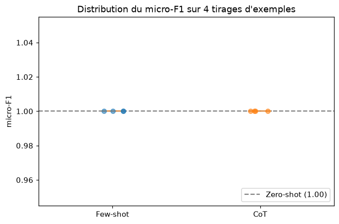

# TP 3 : Prompt Engineering pour l'analyse de sentiment

Classification d'avis de films IMDB en **positif** ou **négatif** à l'aide d'un LLM, sans entraînement de modèle :
on compare trois prompts (zero-shot, few-shot, Chain-of-Thought) avec le score **micro-F1**.

## Contenu du dossier

| Élément | Description |
|---|---|
| [`TP3_Sentiment_Analysis.ipynb`](TP3_Sentiment_Analysis.ipynb) | Notebook Python, **exécuté** (sorties et graphiques inclus) : les 4 étapes de l'énoncé |
| [`REPONSES.md`](REPONSES.md) | Document de réponses, appuyé sur les résultats du notebook |
| [`captures/`](captures) | Captures d'écran du notebook exécuté (code + sorties), une par section |
| [`figures/`](figures) | Graphiques générés par le notebook (enregistrés par `fig.savefig`) |
| [`data/`](data) | `gold_examples.json` (les 20 exemples de référence), `resultats.json` (tous les scores obtenus) et `evaluations_cache.json` (résultats enregistrés au fil de l'exécution) |
| [`pyproject.toml`](pyproject.toml), [`uv.lock`](uv.lock) | Dépendances Python (projet `uv`) |

## Reproduire

1. Placer le fichier `dataset_imdb.zip` fourni avec l'énoncé dans ce dossier (il n'est pas versionné : 27 Mo).
2. Créer une clé d'API gratuite sur [Google AI Studio](https://aistudio.google.com/apikey) et la mettre dans un fichier `.env` :
   ```
   GOOGLE_API_KEY=...
   ```
3. Installer l'environnement et exécuter le notebook :
   ```powershell
   uv sync
   .venv\Scripts\activate
   jupyter nbconvert --to notebook --execute --inplace --ExecutePreprocessor.timeout=-1 TP3_Sentiment_Analysis.ipynb
   ```

Testé avec Python 3.12, `langchain-google-genai` 4.4 et le modèle `gemini-3.5-flash-lite`.
Chaque score est enregistré dans `data/evaluations_cache.json` dès qu'il est calculé, et une nouvelle exécution
réutilise les scores déjà présents. Le dossier contient ce fichier : relancer le notebook réaffiche donc les
résultats sans appeler le modèle. Pour refaire toutes les évaluations, supprimer ce fichier : cela représente
220 appels (3 évaluations simples et 4 tirages répétés, sur 20 avis), soit environ 20 minutes avec la limitation à
0,2 requête par seconde. L'offre gratuite de Gemini est limitée à 500 requêtes par jour pour ce modèle, d'où
4 tirages au lieu des 10 de l'énoncé (voir `REPONSES.md`, 4.2).

## Résultats

| Prompt | Tirages | Micro-F1 moyen | Écart-type |
|---|---|---|---|
| Zero-shot | 1 | 1,000 | 0,000 |
| Few-shot | 4 | 1,000 | 0,000 |
| CoT | 4 | 1,000 | 0,000 |

Aucune erreur sur les 220 prédictions : sur 20 avis de référence, les trois prompts sont équivalents.
L'analyse et les limites sont dans [`REPONSES.md`](REPONSES.md).

## Démarche

| Étape | Contenu |
|---|---|
| 1. Objectifs et métriques | Accuracy et micro-F1 ; vérification de l'exemple de l'énoncé avec `scikit-learn` |
| 2. Données | 50 000 avis IMDB (49 582 après suppression des doublons), séparation 80 % exemples / 20 % exemples de référence, 20 gold examples en JSON |
| 3. Prompts | Zero-shot, few-shot (exemples équilibrés et mélangés par `create_examples`, assemblés par `create_prompt`), Chain-of-Thought |
| 4. Évaluation | `evaluate_prompt` (micro-F1) sur un tirage, puis 4 tirages d'exemples pour le few-shot et le CoT (moyenne et écart-type) |

## Captures d'écran

Les captures de [`captures/`](captures) montrent le notebook exécuté, cellules de code et sorties ensemble.
Elles ont été produites à partir du notebook exécuté (rendu HTML par `nbconvert`, puis capture avec le
navigateur Edge en mode headless).

| Capture | Contenu |
|---|---|
| `01_environnement.png` | Imports, versions des bibliothèques (`session_info`), chargement du `.env` |
| `02_metriques_micro_f1.png` | Exemple de l'énoncé : accuracy, F1 par classe, micro-F1 |
| `03_chargement_donnees.png` | Chargement du zip, doublons, colonnes `text` / `label` / `sentiment`, équilibre des classes |
| `04_exemples_et_gold_examples.png` | Séparation 80/20 et sélection des 20 exemples de référence |
| `05_prompts_zero_shot_few_shot.png` | Prompt zero-shot, `create_examples`, `create_prompt`, prompt few-shot |
| `06_prompt_cot.png` | Prompt Chain-of-Thought |
| `07_modele_et_fonction_evaluation.png` | Configuration de Gemini, enregistrement des résultats et fonction `evaluate_prompt` |
| `08_evaluation_tirage_unique.png` | Micro-F1 des trois prompts sur un tirage d'exemples |
| `09_evaluations_repetees.png` | 4 tirages : moyenne, écart-type, tableau récapitulatif, distribution |

Aperçu :


