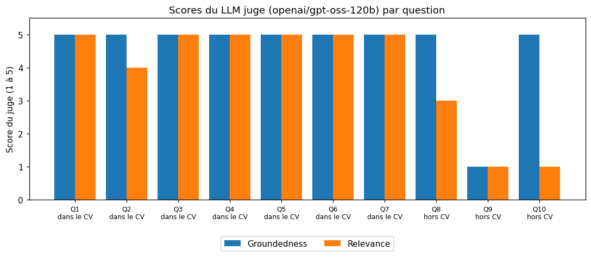

# TP 4 : Implémentation d'un système RAG (Retrieval-Augmented Generation)

Système de questions-réponses sur un document PDF : le document est découpé en chunks, vectorisé et stocké
dans ChromaDB, puis les passages proches de la question sont injectés dans le prompt d'un LLM. Un second LLM
(le **juge**) note ensuite les réponses. Comme demandé dans la consigne, le document utilisé est **mon CV**
et non le PDF fourni (`nc346.pdf`).

## Contenu du dossier

| Élément | Description |
|---|---|
| [`TP4_RAG.ipynb`](TP4_RAG.ipynb) | Notebook Python, **exécuté** (sorties incluses) : chargement, chunking, embeddings, ChromaDB, retriever, prompt, RAG, LLM juge |
| [`REPONSES.md`](REPONSES.md) | Document de réponses, appuyé sur les résultats du notebook |
| [`captures/`](captures) | Captures d'écran du notebook exécuté (code + sorties), une par section |
| [`figures/`](figures) | Graphique des scores du juge (enregistré par `plt.savefig`) |
| [`data/evaluations.json`](data/evaluations.json) | Les 10 questions, les réponses du RAG, les scores et le raisonnement complet du juge |
| [`rag_juge.gif`](rag_juge.gif) | Schéma de l'architecture RAG + juge (fourni avec le TP) |
| [`pyproject.toml`](pyproject.toml), [`uv.lock`](uv.lock) | Dépendances Python (projet `uv`) |

## Modèles utilisés

Je n'ai pas de clé OpenAI, la consigne autorise Ollama ou Gemini. J'ai utilisé des modèles gratuits :

| Rôle | Notebook fourni | Ce TP |
|---|---|---|
| LLM du RAG | `gpt-4o-mini` (OpenAI) | `openai/gpt-oss-20b` (Groq) |
| LLM juge | `gpt-4o` (OpenAI) | `openai/gpt-oss-120b` (Groq) |
| Embeddings | `text-embedding-3-small` (OpenAI) | `gemini-embedding-001` (Google, Groq ne fournit pas d'embeddings) |

## Reproduire

1. Placer un PDF dans le dossier `pdfs/` et adapter la variable `pdf_file` du notebook. Mon CV n'est pas versionné.
2. Créer une clé gratuite sur [Groq](https://console.groq.com/keys) et une sur [Google AI Studio](https://aistudio.google.com/apikey), puis les mettre dans un fichier `.env` :
   ```
   GROQ_API_KEY=...
   GOOGLE_API_KEY=...
   ```
3. Installer l'environnement et exécuter le notebook :
   ```powershell
   uv sync
   .venv\Scripts\activate
   jupyter nbconvert --to notebook --execute --inplace TP4_RAG.ipynb
   ```

Le notebook crée la base vectorielle dans `store/` (non versionnée, recréée à chaque exécution).
Une exécution complète fait environ 60 appels aux LLM et prend quelques minutes avec les limites de l'offre
gratuite de Groq. Testé avec Python 3.10, `langchain` 1.4, `langchain-groq` 1.1 et `chromadb` 1.5.

## Résultats

10 questions : 7 dont la réponse est dans le CV, 3 dont la réponse n'y est pas.

| Type de question | Réponses correctes | Groundedness moyenne | Relevance moyenne |
|---|---|---|---|
| Dans le CV (7) | 7 / 7 | 5,00 / 5 | 4,86 / 5 |
| Hors CV (3) | 3 / 3 répondent `Je ne sais pas!` | 3,67 / 5 | 1,67 / 5 |

Le RAG retrouve toutes les informations du CV et ne fabrique aucune réponse quand l'information manque.
Le juge est instable sur les réponses `Je ne sais pas!` (une note de 1/5 sur trois) ; une précision ajoutée à
son prompt corrige ce cas (section 7.5 du notebook). L'analyse est dans [`REPONSES.md`](REPONSES.md).



## Démarche

| Étape | Contenu |
|---|---|
| 1. Chargement et chunking | `PyPDFLoader`, retrait du téléphone et de l'e-mail, `RecursiveCharacterTextSplitter` (300 tokens, overlap 20) : 10 chunks |
| 2. Embeddings et ChromaDB | `gemini-embedding-001` (vecteurs de 3072 dimensions), collection Chroma persistée dans `store/` |
| 3. Retriever | Recherche par similarité, `k = 5`, test avec les distances |
| 4. Prompt design | Template avec balises `<context>` / `<question>` et consigne `Je ne sais pas!` |
| 5. Réponse du LLM | Appel du LLM avec le prompt complet |
| 6. Application RAG | Fonction `RAG()`, série de 10 questions |
| 7. LLM juge | Groundedness (prompt fourni), relevance (ajoutée), tableau et graphique des scores, amélioration du prompt du juge |

## Captures d'écran

Les captures de [`captures/`](captures) montrent le notebook exécuté, cellules de code et sorties ensemble.
Elles ont été produites à partir du notebook exécuté (rendu HTML par `nbconvert`, puis capture avec le
navigateur Edge en mode headless).

| Capture | Contenu |
|---|---|
| `01_presentation_environnement.png` | Présentation, imports, versions des bibliothèques, chargement du `.env`, test du LLM |
| `02_chargement_chunking.png` | Chargement du PDF, retrait des coordonnées, découpage en 10 chunks |
| `03_embeddings_chromadb.png` | Modèle d'embedding et création de la base Chroma |
| `04_retriever.png` | Retriever `k = 5`, chunks renvoyés et distances |
| `05_prompt_design.png` | Template, fonction `retrieve_context`, prompt complet |
| `06_reponse_llm.png` | Réponse du LLM au prompt |
| `07_application_rag.png` | Fonction `RAG()`, réponses aux 10 questions |
| `08_juge_groundedness.png` | Architecture, prompt du juge, fonction `evaluate`, exemple de raisonnement du juge |
| `09_relevance_evaluation_globale.png` | Métrique de pertinence, scores des 10 questions, moyennes, graphique |
| `10_amelioration_juge_conclusion.png` | Prompt du juge corrigé pour les `Je ne sais pas!`, conclusion |
